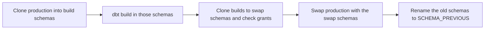

# Atomic promotion for dbt on Snowflake

> dbt builds the next version of a project as a graph of models. Snowflake clones that version beside the schemas readers already use, then swaps the names when the build and the grants check out. Readers never sit on a half-loaded table. This package is the open source runner for that pair. Start with the [ten steps](docs/quickstart.md), then run the [shop example](examples/shop/README.md).

dbt knows which models changed and can test them before anyone switches. Snowflake makes the switch cheap: a schema clone is a metadata copy, and `SWAP WITH` exchanges two schemas in one statement. The package ties those together. Production stays `STAGING` and `MARTS`. The candidate lives in `BUILD_<SCHEMA>_<VERSION>` until `promote_all` swaps it in and keeps the old schemas as `<SCHEMA>_PREVIOUS`.

| Guide | What it is for |
| --- | --- |
| [Ten steps](docs/quickstart.md) | First promotion, from an empty database to rollback |
| [Shop example](examples/shop/README.md) | A two-schema project you can run |
| [Operator guide](docs/guide.md) | Phases, grants, recovery, troubleshooting |
| [Macro reference](docs/reference.md) | Arguments for every public macro |
| [Engineering standard](docs/standards.md) | Rules for changing the package |



Snowflake commits each DDL statement on its own. The swap batch is sequential, not a single database transaction. Grants are checked before any production schema is swapped. If the swap batch stops halfway, follow [Recovery](docs/guide.md#recovery) before running another promotion.

## Requirements

- dbt Core 1.6 or newer
- dbt-snowflake
- A Snowflake role that owns the project schemas and can create schemas, clone, swap, and grant in the target database
- Quoting left off (the dbt-snowflake default). These macros use unquoted identifiers, which Snowflake stores in uppercase.

```yaml
quoting:
  database: false
  schema: false
  identifier: false
```

## Install

From the dbt project that should be promoted:

```yaml
packages:
  - local: /path/to/dbt-atomic-promotion
```

After this folder is published as its own repository, pin a tag:

```yaml
packages:
  - git: "https://github.com/<owner>/dbt-atomic-promotion.git"
    revision: v0.2.0
```

Then run `dbt deps`.

## Schema names

dbt's built-in `generate_schema_name` prefixes a custom schema with `target.schema`. This package does not. A model configured with `+schema: marts` is built in `MARTS` in every environment. Use a separate Snowflake database (or account) per environment.

`generate_schema_name` is only read from the **root** project. Add `macros/generate_schema_name.sql` there:

```jinja

    {{ return(atomic_promotion.promotion_schema_name(custom_schema_name, node)) }}

```

A copy of that wrapper is in [`examples/generate_schema_name.sql`](examples/generate_schema_name.sql).

When `deployment_version` is set, tables, incremental models, views, seeds, and snapshots are built in `BUILD_<SCHEMA>_<VERSION>`. Other materializations stay in the base schema. Ephemeral models are ignored.

Do not name a schema with a `BUILD_` prefix, a `_SWAP` or `_PREVIOUS` suffix, or `_BACKUP_`. Those names belong to this package.

## Project layout

Give each layer a stable schema in `dbt_project.yml`:

```yaml
models:
  my_project:
    staging:
      +schema: staging
    intermediate:
      +schema: intermediate
    marts:
      +schema: marts

vars:
  promotion_log_schema: promotion_logs
  promotion_skip_schemas: []
  cleanup_build_schemas_to_keep: 5
```

`promotion_log_schema` is only for the audit tables. Do not build models into it.

`promotion_skip_schemas` is a list of schema names to leave alone, in any case. A skipped schema is not cloned, swapped, or rolled back.

Models from other dbt packages are ignored unless you set `promotion_packages` to a list of package names.

## Promote a version

The numbered walkthrough is [docs/quickstart.md](docs/quickstart.md). Use one version label for prepare, build, and promote. Dots, dashes, and colons become underscores. A `T` between digits (`20261014T183000`) becomes an underscore. The label is stored in uppercase. Letters, numbers, and underscores are the only characters left after that.

```bash
VERSION="1_4_2_$(date -u +%Y%m%d_%H%M%S)"

dbt run-operation atomic_promotion.prepare_build_schemas --vars "{deployment_version: ${VERSION}}"

dbt build --vars "{deployment_version: ${VERSION}}"

dbt run-operation atomic_promotion.promote_all --args "{version: ${VERSION}, job_name: nightly}"
```

`prepare_build_schemas` clones each production schema into that version's build schema. If production does not exist yet, it creates an empty build schema. Running prepare again for the same version replaces the build schema and discards anything already built there.

`dbt build` (or `dbt run` and `dbt test`) writes into the build schemas. Incremental models continue from the cloned production tables.

`promote_all` fails if any selected build schema is missing, so a partial build is not swapped in.

Pass `schemas` to prepare or promote a subset:

```bash
dbt run-operation atomic_promotion.promote_all --args "{version: ${VERSION}, schemas: [marts]}"
```

Promote the schemas that a view joins together in the same run. The view rewrite only retargets schemas included in that run.

## Roll back and clean up

```bash
dbt run-operation atomic_promotion.rollback_previous --args "{job_name: nightly}"

dbt run-operation atomic_promotion.cleanup_build_schemas --args "{dry_run: true}"
dbt run-operation atomic_promotion.cleanup_build_schemas --args "{num_to_keep: 5}"
```

Rollback swaps every selected schema with `<SCHEMA>_PREVIOUS`. It does nothing unless each selected schema has a backup. The first promotion has no backup.

Cleanup drops build schemas from promoted versions older than the newest N versions recorded in `deployment_log`. It does not drop production, `_PREVIOUS`, `_SWAP`, or build schemas that were never promoted.

## Audit tables

Created in `<database>.<promotion_log_schema>` (default `promotion_logs`):

| Object | What it stores |
| --- | --- |
| `deployment_log` | One row per promoted or rolled-back schema |
| `version_inventory` | Schema snapshot written at the end of a promotion |
| `deployment_summary` | Latest promotion, latest rollback, and `current_state` (`PROMOTED` or `ROLLED_BACK`) |

```bash
dbt run-operation atomic_promotion.check_logging_tables
```

Set `promotion_verbose: true` or `PROMOTION_VERBOSE=true` to print grant details and SQL.

## Limits

- Snowflake only.
- Schema and database names must be unquoted identifiers.
- Schema grants other than `OWNERSHIP` are copied. `SELECT` on existing tables, views, and external tables is copied from one sampled table and checked on one table in the swap schema. Future grants are copied for tables, views, external tables, and materialized views. Other future-grant types stop the promotion before the swap.
- The grant check requires every expected grant to be present. It does not require the grant lists to be identical, because the swap schema has its own owner. A missing grant aborts the promotion.
- View SQL is rewritten by text replace of `BUILD_<SCHEMA>_<VERSION>`. The query after `AS` must start with `SELECT` or `WITH`. A view that mentions the build schema name outside a schema reference is rewritten too.
- `version_inventory` is refreshed on promotion. After a rollback, use `deployment_summary`.
- Seeds and snapshots are included. Ephemeral models are not.

## Operator guide

Setup details, the three phases, verification queries, recovery, and troubleshooting are in [docs/guide.md](docs/guide.md).

## License

Apache License 2.0. See [LICENSE](LICENSE).
